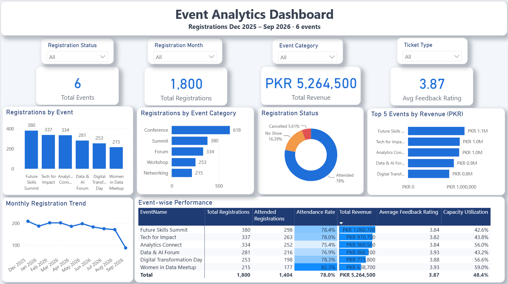
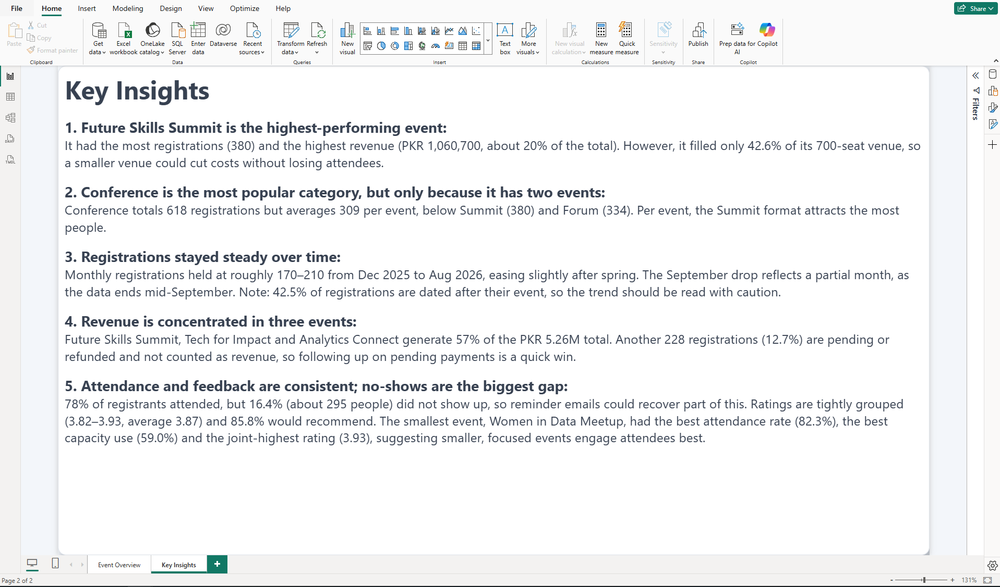
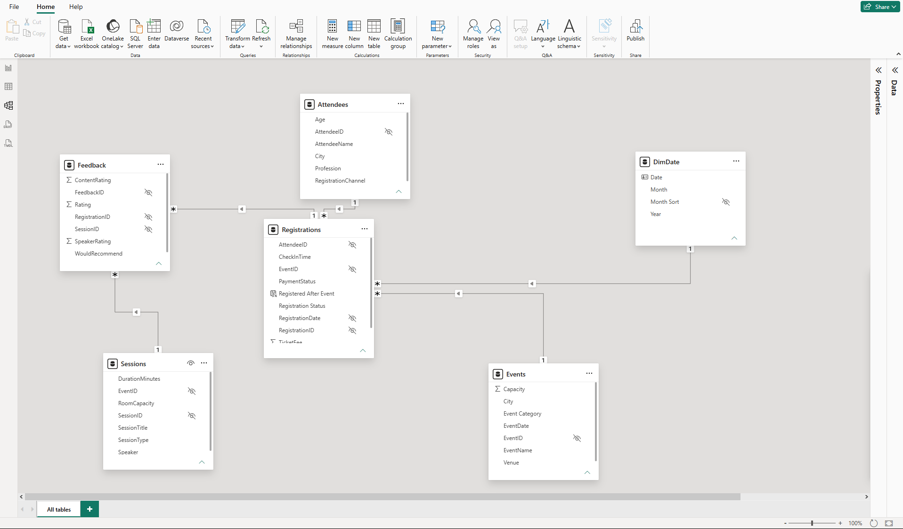

# 🎟️ Event Analytics Dashboard (Power BI)

An end-to-end Power BI project analyzing registrations, revenue, attendance and attendee feedback across 6 tech events in Pakistan: data cleaning in Power Query, a star-schema model, 14 DAX measures, a custom JSON theme, and a one-page interactive dashboard with a separate key insights page.

**Tools:** Power BI Desktop · Power Query (M) · DAX · Data Modeling · JSON Theme  
**Dataset:** Synthetic event data provided for a Power BI class activity at atomcamp. 6 events · 20 sessions · 420 attendees · 1,800 registrations · session feedback records

---

## 📊 Dashboard

### Page 1 — Event Overview

### Page 2 — Key Insights

---

## 🧹 Data Cleaning (Power Query)

| Issue | Fix |
|---|---|
| PaymentStatus in mixed formats (`Paid`, `paid`, ` Paid`) | Trimmed and capitalized to 3 consistent values: Paid, Pending, Refunded |
| Stray spaces in text (`Lahore `, ` Power BI Essentials `) | Trimmed and cleaned across all tables |
| Missing TicketFee on a Professional registration | Filled from the standard price for its ticket type |
| Event and registration dates stored as Excel serial numbers, some with stray decimals | Converted to proper Date types |
| Missing attendee city | Replaced with "Unknown" |
| Blank feedback rating | Left blank so it doesn't drag down the average |
| Session types that don't match their titles (e.g. "Opening Keynote" typed as Workshop) | Noted and left unchanged rather than guessed |
| Registrations dated after their event took place (42.5%) | Flagged with a calculated column and reported as a data-quality finding |
| Data types | Set on every column across every table |

---

## 🗂️ Data Model

- Star schema with two fact tables (Registrations, Feedback) and four dimensions (Attendees, Events, Sessions, DimDate)
- One-to-many relationships with single-direction filtering
- DimDate built in DAX, marked as the date table, with months sorted chronologically
- Sessions → Events left unlinked to avoid an ambiguous filter path. Feedback reaches events through Registrations
- Technical ID columns hidden, and all measures kept in a dedicated _Measures table

---

## 📐 DAX Measures

Total Registrations · Total Events · Total Attendees · Attended Registrations · Attendance Rate · Average Attendance Rate · Total Revenue (paid only) · Paid Registrations · Registration Conversion Rate · Average Feedback Rating · Capacity Utilization · Registrations per Event · Recommend % · % Registered After Event

---

## ⚙️ Report Features

- 4 KPI cards: events, registrations, revenue and average rating
- 4 dropdown slicers: Registration Status, Registration Month, Event Category and Ticket Type
- Top 5 events by revenue using a Top N filter
- Event-wise performance matrix with data bars and a color scale
- Custom JSON theme with rounded white cards, soft shadows and navy headers
- Dedicated Key Insights page

---

## 🔍 Key Findings

- **1,800 registrations and PKR 5.26M in paid revenue** across 6 events. **78% attended**, 16.4% were no-shows and 5.6% cancelled.
- **Future Skills Summit** led in registrations (380) and revenue (PKR 1.06M), but filled only **42.6%** of its 700-seat venue.
- **Conference is the top category (618)** only because it has two events. Per event, Summit draws the most (380 vs 309).
- **Three events generate 57% of revenue.** Another 12.7% of registrations are pending or refunded and excluded from revenue.
- **Smaller events engage best:** Women in Data Meetup had the highest attendance rate (82.3%), the highest capacity use (59.0%) and the joint-top rating (3.93).
- Ratings are tightly grouped (3.82–3.93, average 3.87), and **85.8% would recommend**.
- **Data quality:** 42.5% of registrations are dated after their event, so the monthly trend should be read with caution.

---

## 📁 Files

| File | Description |
|---|---|
| `Event_Analytics_Dashboard.pbix` | Power BI file: cleaned data, model, DAX measures and report |
| `EventTheme.json` | Custom report theme |
| `PowerBI_Event_Analytics_Dataset.xlsx` | Raw source data, before cleaning |

---

## 👤 Author

**Salman Shahzad** — Data Analyst

